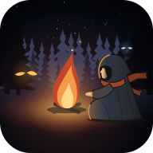

<p align="center"></p>

# Lisière

*Tenir jusqu'au matin.*

Un jeu de survie et d'horreur en Godot 4, branché sur le monde vivant d'[Orvane](https://github.com/stonevalleyoff-ai/orvane). On s'éveille à la lisière d'un lieu vrai du monde : une forêt, une prairie, une lande. Le jour, on récolte, on fabrique, on chasse. La nuit, on tient près d'un feu, et les chasseurs du lieu viennent tourner au bord de la lumière. Chaque bête est une lignée vraie d'Orvane ; ce que le joueur croise et tue est renvoyé au monde.

- **Jouer** : https://stonevalleyoff-ai.github.io/Lisi-re/, dans un navigateur, au clavier ou au doigt (un téléphone tenu à l'horizontale).
- **L'installer comme une application** : depuis cette page, « Installer l'application » (Android, ordinateur) ou « Sur l'écran d'accueil » (iPhone, iPad). Plein écran, et sans réseau une fois ouvert une première fois.
- **Tout le reste** : [LISEZ-MOI.md](LISEZ-MOI.md) (le jeu, ce qui vient d'Orvane, lancer, essayer, exporter, l'application et son icône) et [DIRECTION-ARTISTIQUE.md](DIRECTION-ARTISTIQUE.md) (l'encre et la braise).

```
outils/godot.sh --path .                                  # jouer (Godot 4.3, téléchargé et vérifié la première fois)
outils/godot.sh --headless --path . -- --essai            # l'essai : une partie jouée toute seule
node outils/banc.js                                       # ce qui se vérifie sans Godot
```

Licence : [PolyForm Shield 1.0.0](LICENSE), comme Orvane ; les fontes de `polices/` sont sous licence OFL.
